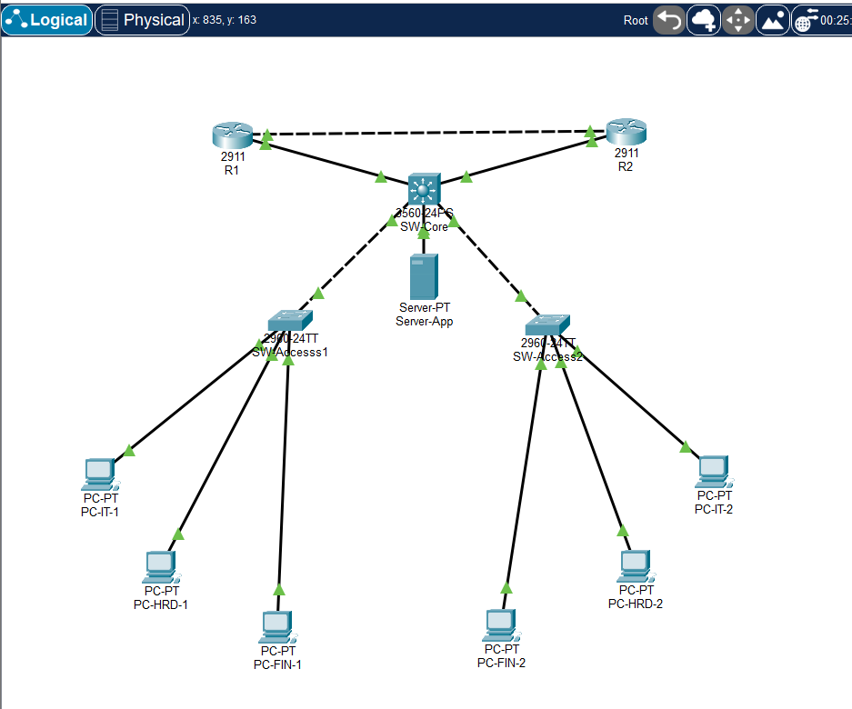
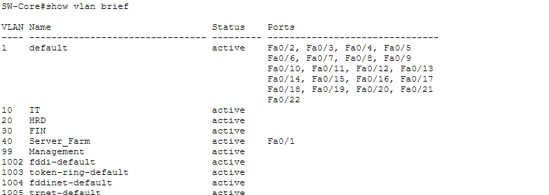
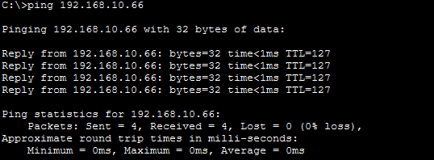
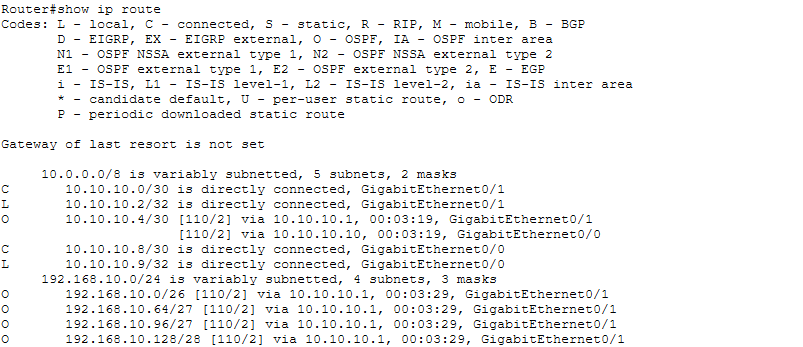
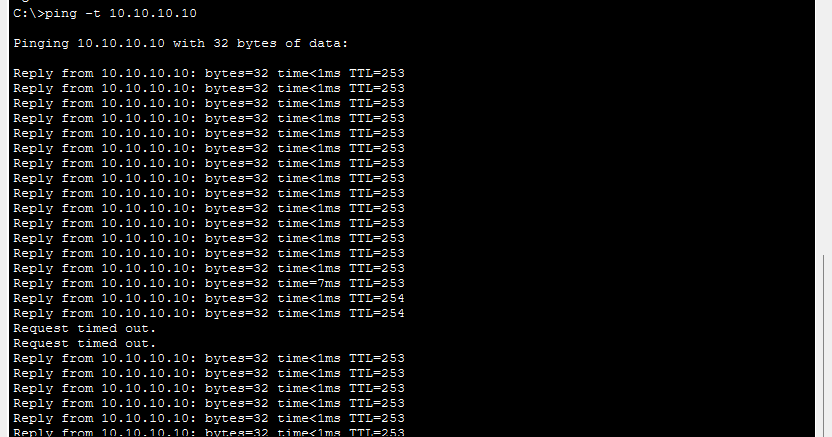

<h1 align="center">🏢 [PERSONAL PROJECT] Multi-Department Enterprise Network</h1>
<h3 align="center">VLAN Segmentation, VLSM & OSPF Redundancy Architecture</h3>

 

> **📝 Deskripsi Proyek**  
> Proyek ini merupakan simulasi arsitektur jaringan skala *Enterprise* yang dirancang untuk menjamin ketersediaan tinggi (*High Availability*), keamanan segmentasi data, dan efisiensi alokasi IP. Dibangun menggunakan **Cisco Packet Tracer**, topologi ini meniru skenario dunia nyata di mana sebuah perusahaan membutuhkan isolasi *broadcast domain* antar departemen, *routing* internal berkinerja tinggi, dan jalur *backbone* yang kebal terhadap kegagalan perangkat keras (Zero-Downtime Tolerant) melalui konvergensi dinamis.

---

  
  
<i>Topologi fisik jaringan Enterprise yang terdiri dari 2 Router Distribusi (R1, R2), 1 Multilayer Switch sebagai Core (SW-Core), 2 Access Switch, dan titik akhir (PC/Server) yang tersebar di berbagai VLAN.</i>

---

## 🚀 Fitur Utama & Teknologi

*   🔐 **VLAN & 802.1Q Trunking:** Isolasi *broadcast domain* secara logis untuk departemen (IT, HRD, Finance, Server Farm, Management). Mengurangi risiko *broadcast storm* dan membatasi akses tidak sah antar divisi.
*   📐 **VLSM (Variable Length Subnet Mask):** Desain hierarki IP Address yang presisi dan efisien, mencegah pemborosan IP publik/privat dengan menyesuaikan porsi *host* sesuai kebutuhan aktual departemen.
*   ⚡ **SVI (Switch Virtual Interface):** Implementasi *Inter-VLAN Routing* pada Layer 3 Multilayer Switch. Mengalihkan beban *routing* internal dari Router distribusi ke Switch Core untuk latensi yang jauh lebih rendah (*wire-speed routing*).
*   🔄 **OSPF (Open Shortest Path First):** Protokol *Dynamic Routing* (Area 0) yang diterapkan pada *backbone* (SW-Core, R1, R2). Memberikan sinkronisasi rute instan dan algoritma *failover* otomatis jika terjadi pemutusan jalur fiber/kabel utama.

---

## 🗂 Arsitektur Alokasi IP (VLSM)

**1. Jaringan Internal & End-Devices (VLAN)**

| VLAN ID | Departemen | Network Address | Subnet Mask | Gateway (SVI) | Usable IP Range |
|:---:|---|---|---|---|---|
| **10** | 💻 IT | `192.168.10.0/26` | `255.255.255.192` | `192.168.10.1` | `.2 - .62` |
| **20** | 👥 HRD | `192.168.10.64/27` | `255.255.255.224` | `192.168.10.65` | `.66 - .94` |
| **30** | 📈 Finance | `192.168.10.96/27` | `255.255.255.224` | `192.168.10.97` | `.98 - .126` |
| **40** | 🗄️ Server Farm | `192.168.10.128/28` | `255.255.255.240` | `192.168.10.129` | `.130 - .142` |
| **99** | ⚙️ Mgmt (Native) | `192.168.10.144/29` | `255.255.255.248` | `192.168.10.145` | `.146 - .150` |

**2. Jaringan Backbone Point-to-Point (/30)**

| Link / Jalur | Network Address | Subnet Mask | IP Antarmuka |
|---|---|---|---|
| **SW-Core ↔ R1** | `10.10.10.0/30` | `255.255.255.252` | SW-Core: `.1` \| R1: `.2` |
| **SW-Core ↔ R2** | `10.10.10.4/30` | `255.255.255.252` | SW-Core: `.5` \| R2: `.6` |
| **R1 ↔ R2** | `10.10.10.8/30` | `255.255.255.252` | R1: `.9` \| R2: `.10` |

---

## 🔬 Pengujian & Verifikasi Kinerja

### 1. Verifikasi Database VLAN
Membuktikan bahwa segmentasi *logic* untuk setiap departemen telah terdaftar dan beroperasi dengan benar pada perangkat Access/Core Switch.

 <i>Output CLI: `show vlan brief` menampilkan status aktif untuk seluruh VLAN operasional.</i>

### 2. SVI & Inter-VLAN Routing Test
Menguji konektivitas lintas-departemen. Gateway pada Multilayer Switch berhasil menjembatani komunikasi *Node-to-Node* dari jaringan yang berbeda secara independen.

 <i>ICMP Echo Test: PC dari VLAN 10 (IT) berhasil menerima Reply dari PC di VLAN 20 (HRD) dan Server Farm.</i>

### 3. Konvergensi Tabel Routing OSPF
Memastikan protokol OSPF aktif di *Area 0* dan seluruh *Router Layer* Distribusi telah mempelajari topologi lantai bawah (VLAN) secara dinamis tanpa perlu konfigurasi *Static Route*.

 <i>Output CLI: `show ip route` pada R1. Flag `O` memvalidasi bahwa Router telah mengenali rute spesifik menuju VLAN via Gateway SW-Core.</i>

### 4. Stress-Test: Redundancy & Failover OSPF 🌟
Pengujian titik kritis (*Single Point of Failure*). Paket ICMP dikirimkan terus-menerus melewati jalur tulang punggung utama. Ketika antarmuka fisik utama dimatikan secara paksa (`shutdown`), OSPF merespons perubahan topologi seketika.

 <i>Hasil Observasi: Koneksi mengalami Request Timed Out (RTO) sesaat ketika kabel terputus. Algoritma Dijkstra pada OSPF langsung mendeteksi metrik alternatif dan membelokkan lalu lintas via Router cadangan. Ping kembali Reply secara otomatis (Self-Healing Network).</i>

---

## 🛠️ Cara Penggunaan (Reproduce)

Jika Anda ingin menjalankan simulasi ini secara lokal:

1. 📥 Unduh/Clone repositori ini dan cari file `Enterprise-Network-Failover.pkt`.
2. ⚙️ Buka file menggunakan **Cisco Packet Tracer** *(Disarankan: Versi 9.0.1 atau lebih baru)*.
3. 🔑 Akses perangkat (jika diminta *password* mode `enable`): ketik `admin`.
4. 🧪 **Eksperimen Mandiri:** 
   * Buka *Command Prompt* di PC IT dan jalankan `ping 10.10.10.10 -t`.
   * Buka CLI pada `SW-Core`, masuk ke `interface g0/2`, lalu jalankan perintah `shutdown`.
   * Amati Command Prompt PC untuk melihat algoritma OSPF melakukan *failover* *routing* secara nyata.

---

  <i>Dibuat sebagai bagian dari Portofolio Network Engineering.   Terbuka untuk diskusi teknis dan saran!</i>

